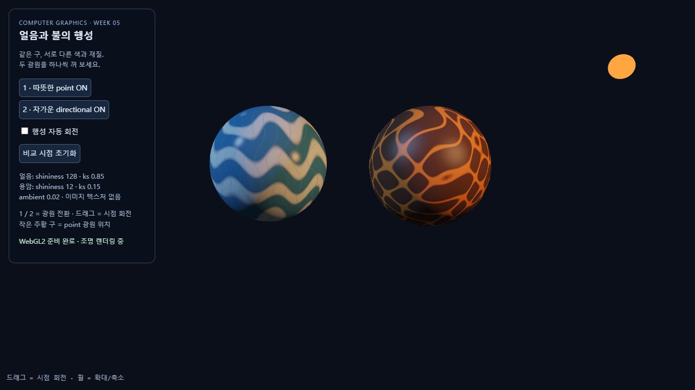

# Computer Graphics Week 05

Lighting and Color — Phong Lighting Model

## Task 1: Lighting Experiments

[실행하기](https://a1141114a.github.io/week2/week5/task1.html) · [소스](task1.html)

교수님이 제공한 `w5-start.html`을 바탕으로 제작한 컴퓨터 그래픽스(CG) 과제입니다. 단계별 Phong 조명, max 제거, 법선 행렬 및 세 종류의 광원을 비교하였습니다.

[전체 실험 보고서: week5.md](week5.md)

## Task 2: Creative Lighting Scene

[실행하기](https://a1141114a.github.io/week2/week5/task2.html) · [소스](task2.html)

### 얼음과 불의 행성

이전에 3주차 과제에서 얼음 행성과 용암 행성을 만든 적이 있어서, 이번에도 같은 주제를 선택하였다. 두 행성의 색상 대비가 뚜렷하게 나타나는 점이 마음에 들었다. 전체적인 모습은 이전과 비슷하게 유지하면서, 이번에 배운 조명을 적용해 두 행성의 차이를 표현하고 싶었다.

따뜻한 Point Light와 차가운 Directional Light를 사용하였다. 키보드 `1`, `2` 또는 화면의 버튼으로 각 광원을 켜고 끌 수 있다.

최종 결과를 보니 따뜻한 조명 아래에서는 얼음 행성도 따뜻한 색을 띠면서, 두 행성의 전체적인 색감이 생각보다 비슷하게 보였다.

### AI 활용

AI는 일부 코드 작성과 README 문장의 표현을 다듬는 데 활용하였다.

