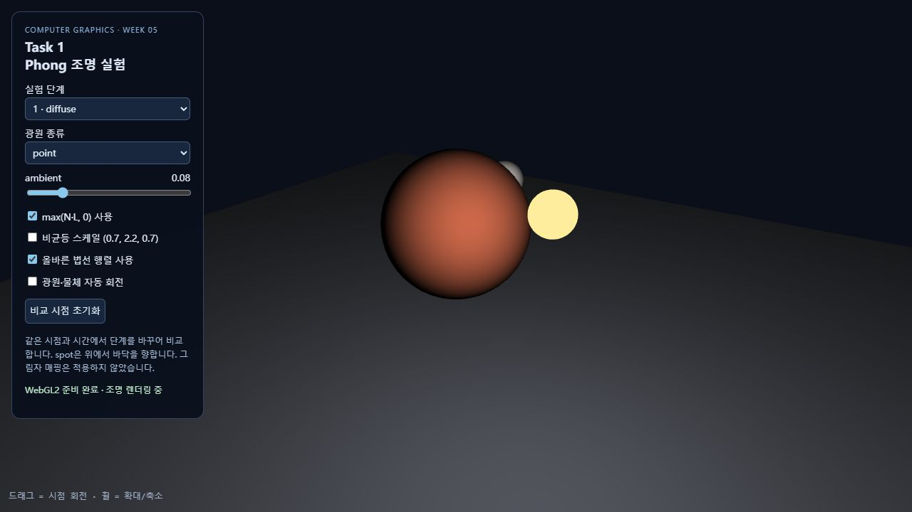
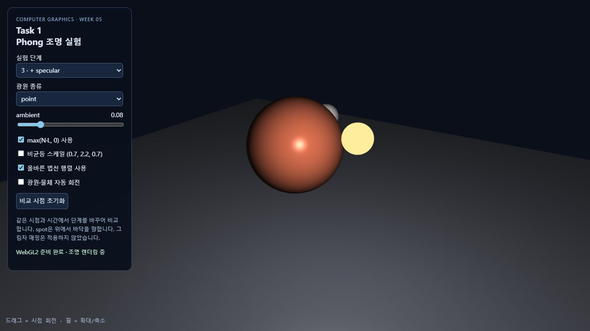
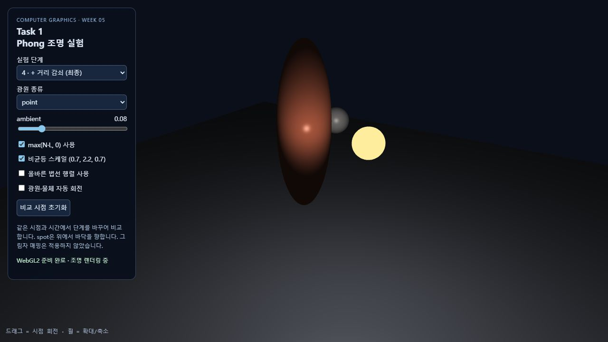
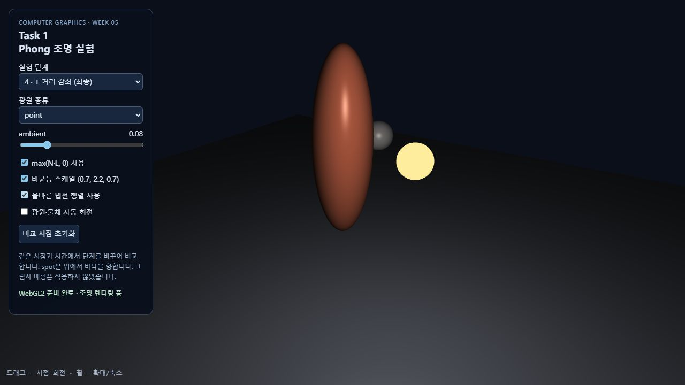
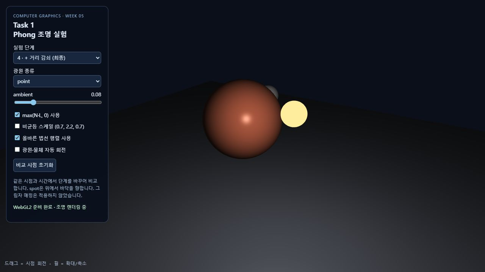
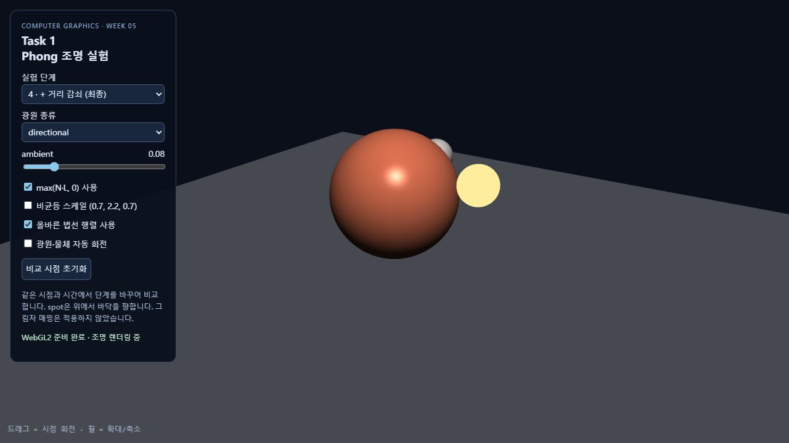
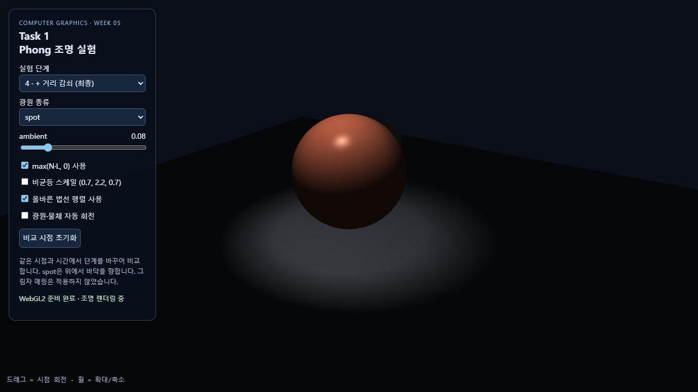
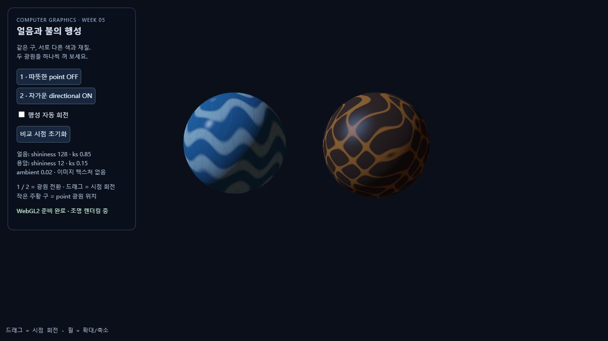
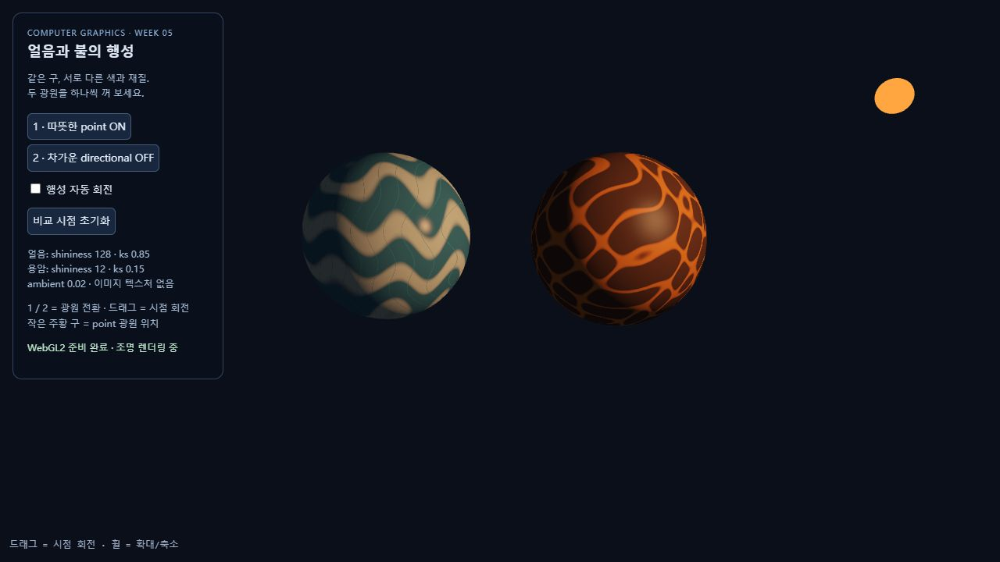

# Computer Graphics Week 05

Lighting and Color — Phong Lighting Model

교수님이 제공한 `w5-start.html`의 구 메시, 행렬, WebGL 렌더링 및 카메라 구조를 바탕으로 제작하였다. 외부 그래픽 라이브러리는 사용하지 않았다.

- [Task 1 실행](https://a1141114a.github.io/week2/week5/task1.html) · [코드](task1.html)
- [Task 2 실행](https://a1141114a.github.io/week2/week5/task2.html) · [코드](task2.html)

## Task 1: Lighting Experiments

### 1. 조명 단계 비교

애니메이션을 정지하고 동일한 카메라 각도와 광원 위치에서 촬영하였다. 화면의 Stage 선택으로 단계를 전환할 수 있다.

#### Stage 1 — Diffuse

`max(dot(N, L), 0.0)`으로 확산광을 계산하였다. 광원을 향한 면은 밝고 반대쪽은 검게 나타난다.

#### Stage 2 — Ambient 추가

기본 색상에 환경광 계수 `0.08`을 적용하여 직접 빛을 받지 않는 부분에도 기본 밝기가 남는다.

#### Stage 3 — Specular 추가

반사 벡터와 시선 방향을 이용한 Phong 정반사를 더하였다. 정반사 계수는 `0.5`, 행성과 작은 구의 shininess는 각각 `32`, `16`이다.

#### Stage 4 — Attenuation 추가

Point Light에 거리 감쇠 `1 / (1 + 0.02 * d * d)`를 적용하였다. 환경광에는 거리 감쇠를 적용하지 않았다.

### 2. max 제거 실험

**실험 전 예상:** max를 제거하면 화면이 과도하게 밝아질 것이라고 예상하였다.

**실제 결과:** 하지만 실제로는 빛을 등진 부분이 여전히 검게 보였으며, 예상했던 과다 노출 현상은 나타나지 않았다.

아래는 Stage 1에서 max를 제거한 보충 실험 화면이다. 음수인 확산광 값이 화면에 표시될 때 검은색으로 제한되므로 뒷면이 더 밝아지지 않는다. 다른 조명 항과 합산하면 음수 값이 전체 밝기를 낮출 수 있으므로 max의 역할이 없어진 것은 아니다.

### 3. 비균등 스케일과 법선 행렬

`(0.7, 2.2, 0.7)`의 비균등 스케일을 적용하고 `mat3(model)`과 역전치 법선 행렬을 비교하였다. 변환한 법선은 정규화하였다.

| 모델 행렬로 법선 변환 | 역전치 법선 행렬 사용 |
| --- | --- |
|  |  |

비균등 스케일로 물체를 길게 늘인 상태에서 비교해 보니, 올바른 법선 행렬을 사용한 두 번째 결과가 더 자연스럽게 보였다.

### 4. 세 가지 광원 비교

Stage 4에서 같은 시점으로 비교하였다. Point Light에는 위치에 따른 방향과 거리 감쇠를 적용하였다. Directional Light에는 일정한 방향을 사용하고 거리 감쇠는 적용하지 않았다. Spot Light에는 위치, 방향과 원뿔 범위를 적용하였다. 안쪽 각도는 16도, 바깥쪽 각도는 28도이다.

#### Point Light — 비교 기준

#### Directional Light

#### Spot Light

세 가지 광원을 비교해 보니, 광원의 종류에 따라 물체와 바닥의 밝기, 그리고 어두운 부분의 형태가 조금씩 다르게 나타났다. 이 장면은 표면의 명암을 비교하며, 다른 물체에 드리워지는 그림자를 생성하는 shadow mapping은 구현하지 않았다.

## Task 2: Creative Lighting Scene

### 1. 제작 의도

이전에 3주차 과제에서 얼음 행성과 용암 행성을 만든 적이 있어서, 이번에도 같은 주제를 선택하였다. 두 행성의 색상 대비가 뚜렷하게 나타나는 점이 마음에 들었다. 전체적인 모습은 이전과 비슷하게 유지하면서, 이번에 배운 조명을 적용해 두 행성의 차이를 표현하고 싶었다.

### 2. 제작 방법

반지름 `1.35`인 두 구를 나란히 배치하였다. 얼음 행성의 중심은 `(-1.85, 1.7, 0)`, 용암 행성의 중심은 `(1.85, 1.7, 0)`이다. 셰이더에서 수학 함수와 색상 보간으로 얼음 무늬와 용암 균열을 만들었다.

| 광원 | 위치 또는 방향 | 색상 및 처리 |
| --- | --- | --- |
| 따뜻한 Point Light | 위치 `(4.5, 3.6, 3.0)` | 주황색 `(3.0, 1.1, 0.35)`, 감쇠 `1/(1+0.02d²)` |
| 차가운 Directional Light | 표면에서 광원으로 향하는 방향 `normalize(-0.7, 0.65, 0.4)` | 파란색 `(0.35, 0.65, 1.25)`, 거리 감쇠 없음 |

환경광은 기본 색상의 `0.02`로 약하게 적용하였다. 조명을 합산한 뒤 톤 매핑과 감마 보정을 적용하였다. 작은 주황색 구는 Point Light의 위치 표시이다.

| 물체 | 기본 색상 | Shininess | 정반사 계수 |
| --- | --- | --- | --- |
| 얼음 행성 | 파랑과 흰색, 얼음 결 | 128 | 0.85 |
| 용암 행성 | 어두운 암석과 주황·붉은 균열 | 12 | 0.15 |

얼음은 작고 강한 하이라이트, 용암은 넓고 약한 하이라이트가 나타나도록 설정하였다. 용암 균열은 조명을 받는 표면 색상이며 별도의 자체 발광 항은 사용하지 않았다.

### 3. 광원 켜기와 끄기

키보드 `1`은 따뜻한 광원, `2`는 차가운 광원을 전환한다. 화면의 버튼으로도 전환할 수 있다. 마우스 드래그와 휠로 시점을 조작할 수 있다. 비교 화면은 애니메이션을 정지하고 동일한 시점에서 촬영하였다.

#### 따뜻한 광원 끄기

따뜻한 광원을 끄면 주황색 조명이 줄어들면서 화면 전체의 색감이 차가워지고, 용암 행성은 더 어둡게 보였다.

#### 차가운 광원 끄기

반대로 차가운 광원을 끄면 파란빛을 받는 영역이 줄어들어 화면이 전체적으로 따뜻한 색감을 띠었고, 얼음 행성에도 주황빛과 노란빛이 나타났다.

#### 두 광원 모두 끄기

두 광원을 모두 끄면 아주 약한 환경광만 남아서 두 행성 모두 눈에 띄게 어두워졌다.

### 4. 최종 결과

최종 결과를 보니 따뜻한 조명 아래에서는 얼음 행성도 따뜻한 색을 띠면서, 두 행성의 전체적인 색감이 생각보다 비슷하게 보였다.

### 5. AI 활용

AI는 일부 코드 작성과 README 문장의 표현을 다듬는 데 활용하였다. 얼음과 용암 행성에 따뜻한 Point Light와 차가운 Directional Light를 적용하는 구현 및 실험 정리를 요청하였다. 실험의 예상과 결과, 주제 선정 이유와 감상은 직접 설명하였으며, 이를 한국어로 정리하는 데 도움을 받았다. 결과를 확인한 뒤에는 별도의 수정 요청을 하지 않았다.
