# Computer Graphics Week 06

## PBR과 텍스처 매핑

교수님이 제공한 `week06-material-starter.zip`을 바탕으로 `task1.js`의 TODO 1–5를 구현하였다. 실습 2는 완성한 실습 1의 PBR·텍스처·법선맵 계산을 구형 행성에 옮겨 제작하였다.

- [Task 1 — 재질 실험실 실행](https://a1141114a.github.io/week2/week6/task1.html?rev=6.3)
- [Task 2 — 페룸 금속 행성 실행](https://a1141114a.github.io/week2/week6/task2.html?rev=6.3)

## Task 1 — 같은 형상, 다른 재질

### 구현 내용

| 단계 | 구현 | 코드에서 찾을 부분 |
| --- | --- | --- |
| 1 · 색 맵 | UV로 색 맵을 읽고 sRGB에서 선형 공간으로 변환 | `uStage>=1`, `srgbToLinear` |
| 2 · PBR | GGX D, Schlick F, Smith–Schlick G, 확산·정반사의 에너지 배분 | `directPBR` |
| 3 · ARM | R=AO, G=roughness, B=metallic | `uStage>=3` |
| 4 · Normal | RGB×2−1로 복원하고 위치·UV 미분의 TBN으로 변환 | `uStage>=4` |
| 5 · 환경 반사 | `reflect(-V,N)`으로 파노라마 조회, roughness로 밉 레벨 선택 | `uStage>=5` |

색과 환경 이미지만 선형화한다. normal·ARM은 수치 데이터로 읽는다. AO는 상수 ambient와 간단한 환경 반사 근사에 적용하고 직접광에는 적용하지 않는다. 마지막에 Reinhard 톤 매핑과 sRGB 변환을 한 번 적용한다. 환경 반사는 LDR 이미지와 일반 밉맵을 이용한 교육용 근사이며 정확한 GGX IBL 적분은 아니다.

### 같은 시점의 단계 1·3·4 비교

같은 카메라와 녹슨 금속 재질을 유지하였다. 단계 1은 색 맵과 Phong, 단계 3은 PBR과 ARM, 단계 4는 법선맵까지 적용한 상태다. 단계 3과 4는 환경 반사를 아직 더하지 않으므로 법선맵에 의한 명암 차이를 분리해서 볼 수 있다.

| 단계 1 | 단계 3 | 단계 4 |
| --- | --- | --- |
| 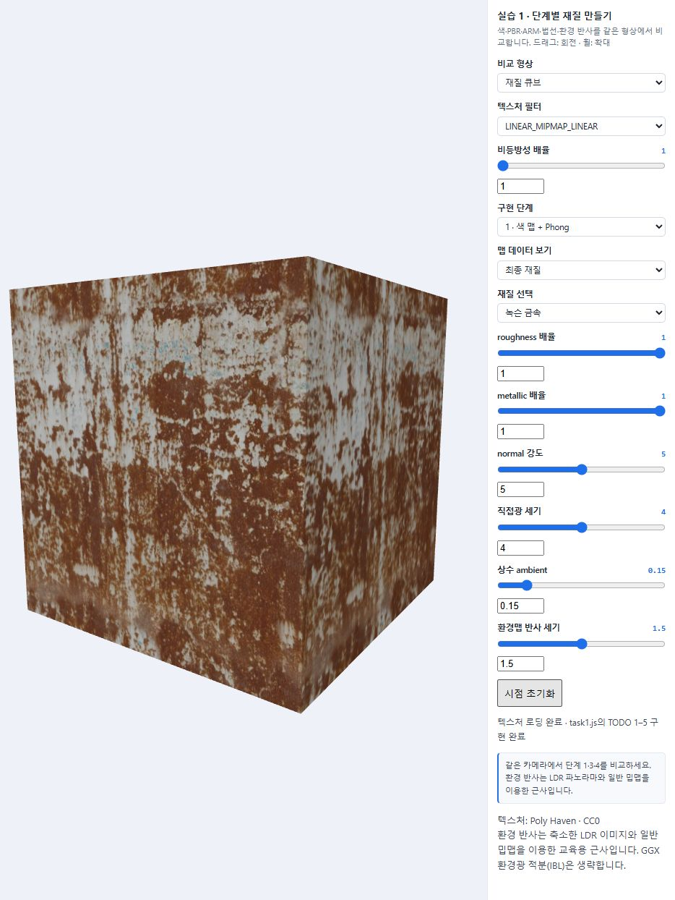 | 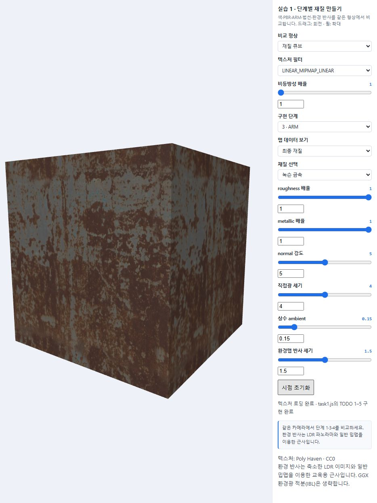 |  |

### 금속과 녹 영역

ARM의 B 채널이 밝은 부분은 금속, 어두운 녹 영역은 유전체로 처리한다. 녹은 색만 갈색으로 바뀌는 것이 아니라 metallic이 낮고 roughness가 높아 반사의 성질도 달라진다. 나무와 돌은 metallic 맵이 거의 0이므로 배율을 올려도 금속으로 바뀌지 않는다.

| 녹슨 금속 | 나무 | 돌 |
| --- | --- | --- |
| 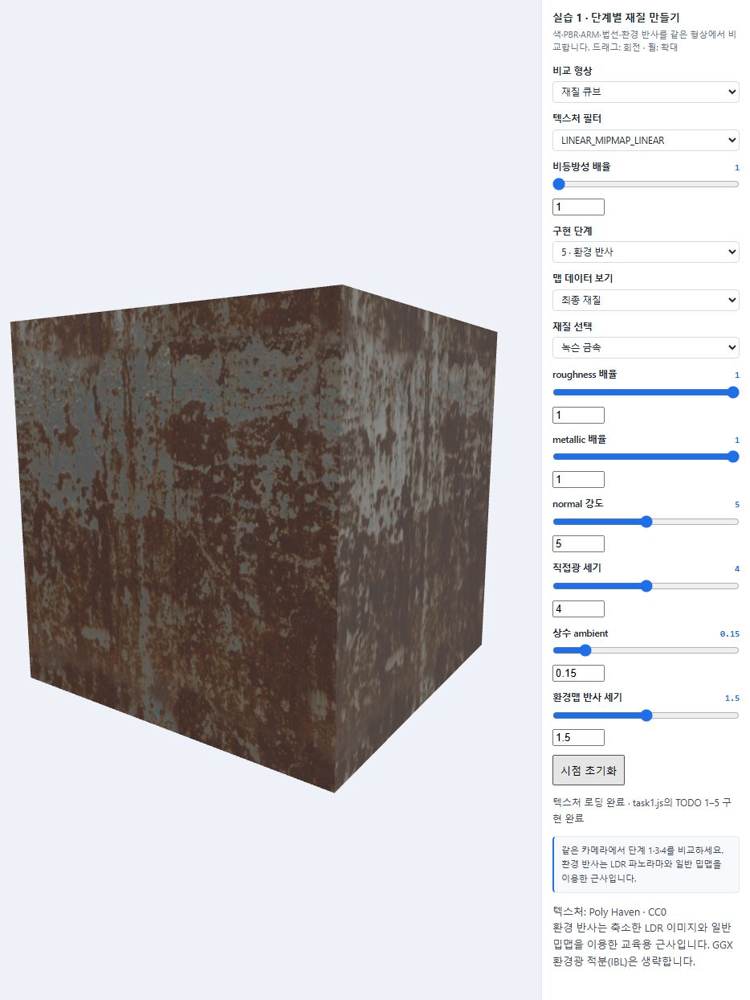 | 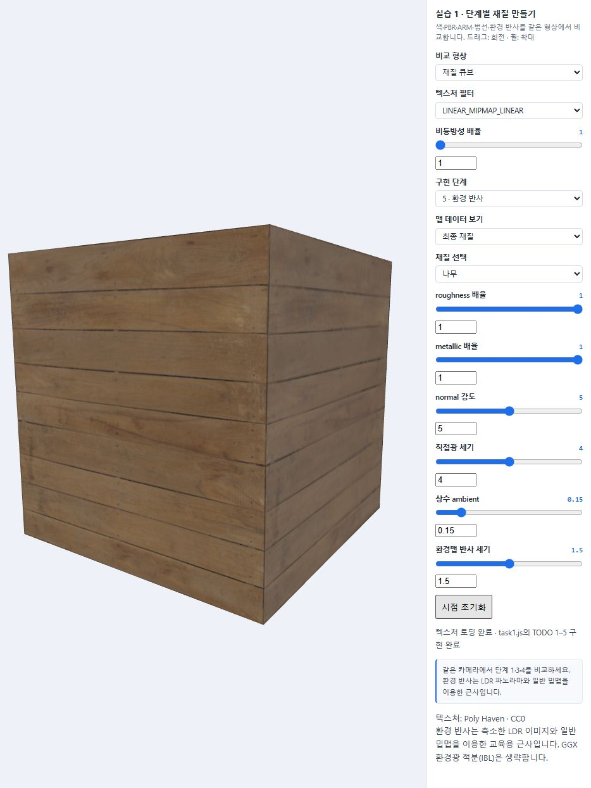 | 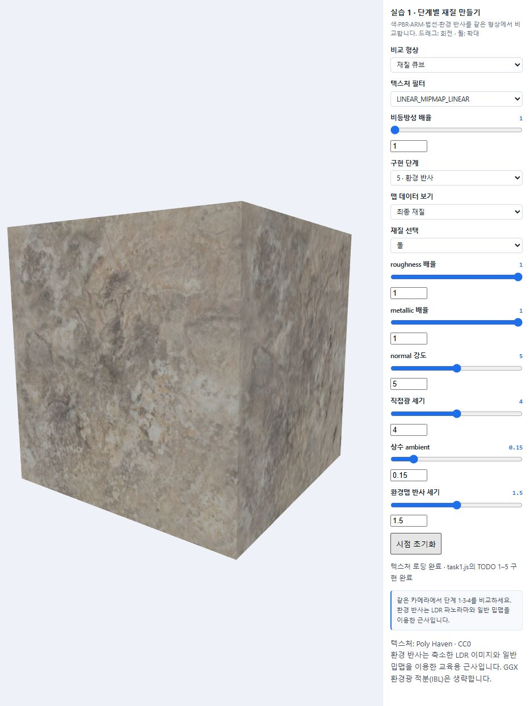 |

법선맵은 조명에 사용하는 방향만 바꾸므로 메시의 정점 수와 큐브의 외곽선은 바뀌지 않는다. roughness는 한 점에서의 미세면 방향 분포, normal map은 위치별 대표 법선을 조절한다.

### 필터링 비교

`비스듬한 반복 바닥` 모드에서 같은 시점과 재질을 유지하고 두 필터를 비교하였다.

| NEAREST | LINEAR_MIPMAP_LINEAR |
| --- | --- |
| 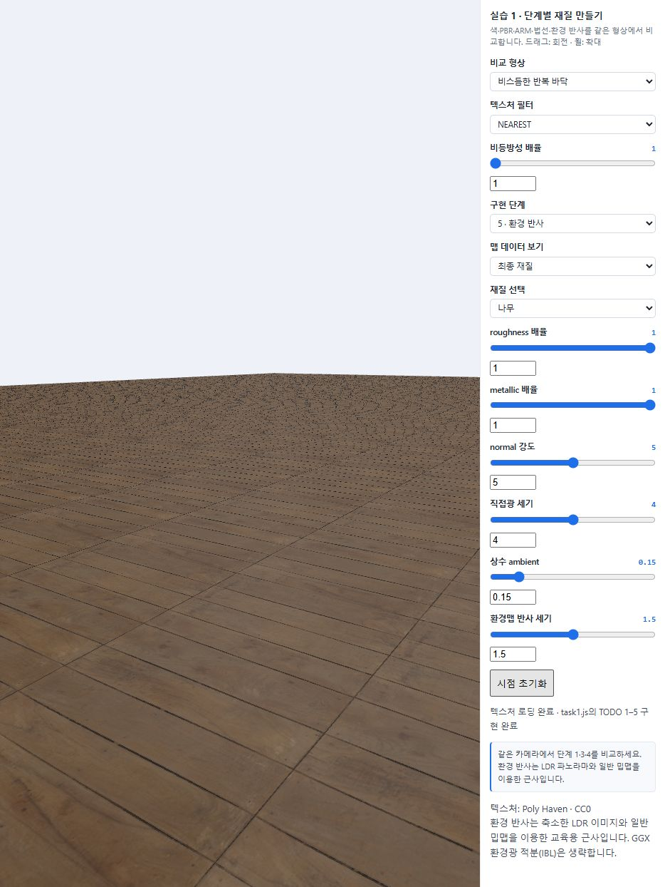 |  |

NEAREST는 가장 가까운 텍셀 하나를 사용하므로 먼 반복 무늬에서 aliasing이 나타날 수 있다. Trilinear는 적절한 두 밉 레벨에서 bilinear 샘플을 혼합하여 축소 시의 고주파 무늬를 완화한다. 비등방성 확장이 지원되는 경우 기기의 상한 이내에서 배율을 추가 조절할 수 있다. 필터링은 원본에 없는 확대 세부를 새로 만들지는 않는다.

### 빛 경로 확인

직접광과 상수 ambient를 0으로 두고 환경 반사만 켠 상태, 세 경로를 모두 끈 상태를 비교하였다. 비발광 물체는 모든 광원을 끄면 검게 보인다. 환경맵을 끄는 것과 상수 ambient를 끄는 것은 별도 조작이다.

| 환경 반사만 | 모든 빛 경로 끄기 |
| --- | --- |
| 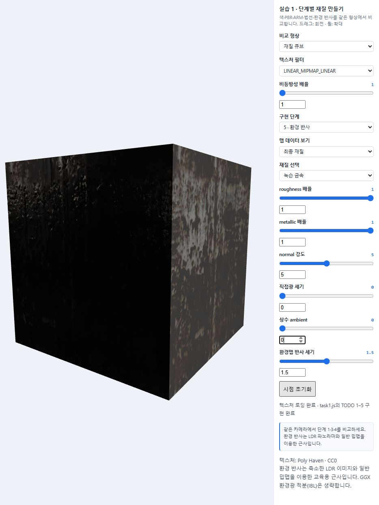 | 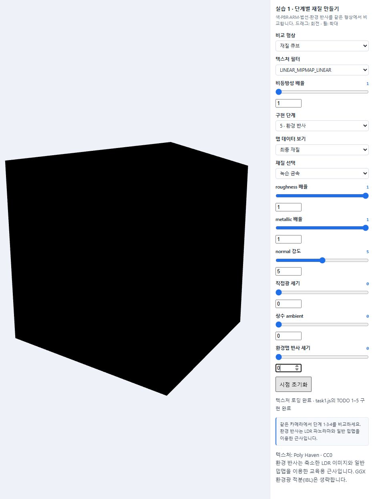 |

## Task 2 — 페룸: 변화하는 금속 행성

### 제작 의도

태양의 가열이 금속으로 이루어진 행성에서 더 뚜렷하게 나타날 것이라고 생각하여 금속 행성을 선택하였다. 금속이 녹거나 산화하고, 빛과 열을 내는 모습을 떠올렸다. 이번 구현에서는 그중 산화에 따른 표면 변화와 운석 충돌로 드러나는 금속의 차이에 집중하였다.

### 두 원인과 재질 규칙

| 원인 / UI | 영향받는 위치와 마스크 | PBR 재질 변화 |
| --- | --- | --- |
| 태양 가열 / 접근 0–100 | 행성이 태양에 가까워지고, 향한 면의 산화 영역이 확장된다. `oxidationRegion`에서 광원 방향과 기하 법선의 내적, 작은 국소 패턴을 사용한다. | 갈색 계열로 변화, roughness 0.91, metallic 0으로 혼합 |
| 운석 충돌 누적 0–100 | `impactRegion`에서 로컬 구면에 고정된 18개 중심의 활성 비율과 반경을 연속적으로 늘린다. | 밝은 금속 노출, roughness 0.19, metallic 1로 혼합 |

첫 조건은 행성의 위치 및 태양에서 받는 거리 감쇠와 연결된다. 둘째 조건은 첫 조건과 독립적이며 행성이 자전해도 충돌 흔적이 표면에 붙어 있도록 로컬 좌표를 사용한다. 태양은 밝은 구로 표시하고 별도의 직접광으로 행성을 비춘다. 밝은 구의 emission 자체가 주변 물체를 자동으로 비추는 것은 아니다.

기본 표면은 rock 텍스처를 바탕 무늬로 이용한 회청색 금속이다. Metallic은 0.95이며 roughness는 ARM의 G×0.45이다. 실습 1의 normal map과 TBN, PBR D·F·G를 재사용하였다. 산화와 충돌은 색상뿐 아니라 roughness·metallic을 함께 바꾼다. 겹치는 위치에서는 나중에 적용한 새 충돌 흔적이 우선한다.

이는 실제 대기 화학이나 충돌 지형의 정밀 시뮬레이션이 아니라 두 원인과 위치별 재질을 연결한 창작 규칙이다. 실제 형상이 파이는 분화구, 용융 유체, bloom은 구현 범위에 포함하지 않았다.

### 조건을 0·50·100으로 비교

자전을 정지하고 같은 카메라를 유지하였다. 가열 비교에서는 충돌을 50으로 고정하고, 충돌 비교에서는 가열을 50으로 고정하였다.

| 가열 0 | 가열 50 | 가열 100 |
| --- | --- | --- |
| 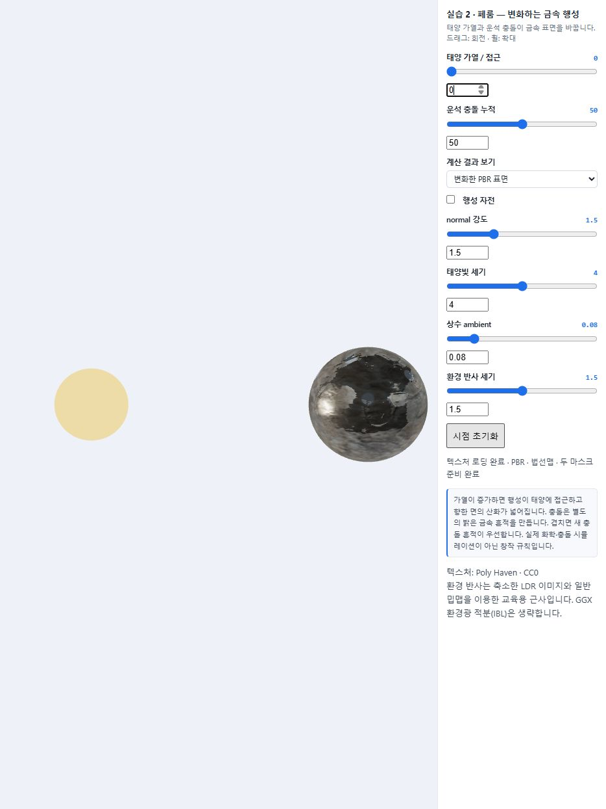 |  | 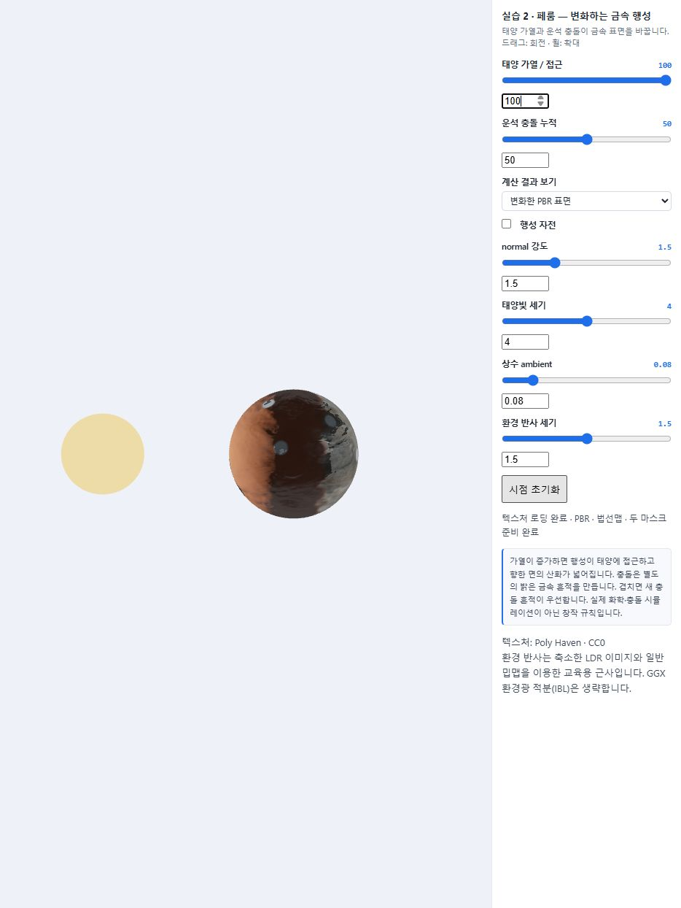 |

| 충돌 0 | 충돌 50 | 충돌 100 |
| --- | --- | --- |
| 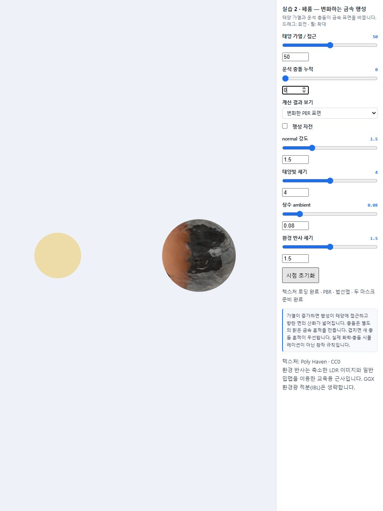 | 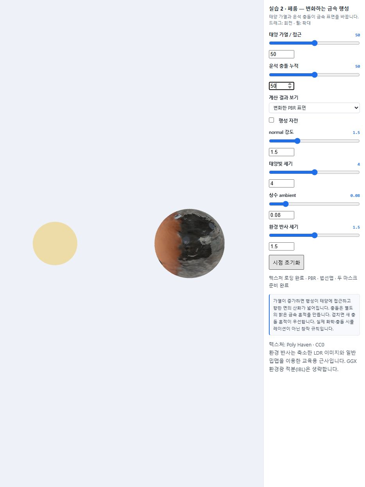 | 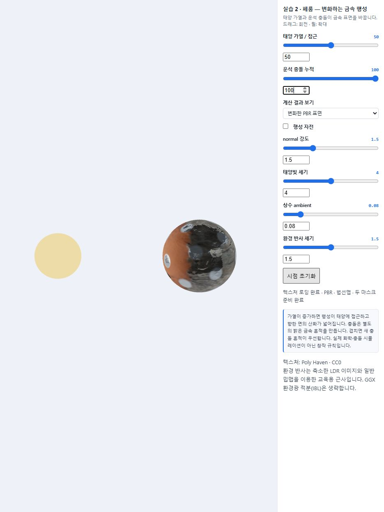 |

### 흑백 마스크 진단

조명이나 톤 매핑을 적용한 색이 아니라 계산된 0–1 값을 직접 표시한다. 검정은 영향 없음, 흰색은 완전 적용, 회색은 혼합 경계다.

| 산화 마스크 | 충돌 마스크 |
| --- | --- |
| 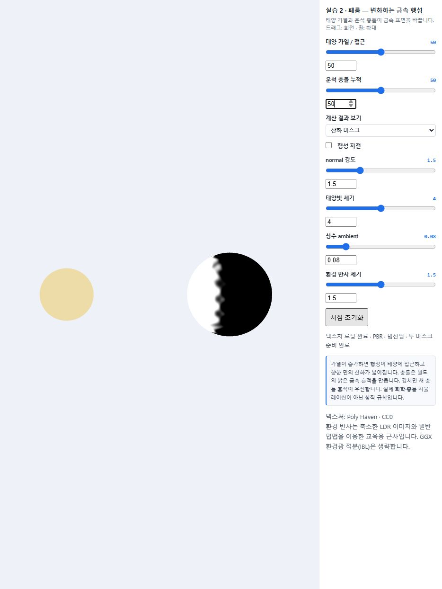 |  |

### 기본 / 변화한 표면

같은 조건과 시점에서 보기 모드만 전환하였다.

| 기본 금속 | 산화와 충돌 적용 |
| --- | --- |
|  |  |

### 관찰 기록

산화 영역과 충돌 흔적의 차이가 비교적 뚜렷하게 보였으며, 처음에 상상했던 모습과 잘 맞았다.

## 이미지 출처와 라이선스

교수님 ZIP에 포함된 Poly Haven의 CC0-1.0 자료를 사용하였다. 파일별 원본 주소와 축소 처리 기록은 [sources.json](assets/week06/sources.json)에 있다.

- [Wood Planks](https://polyhaven.com/a/wood_planks)
- [Rusty Metal 04](https://polyhaven.com/a/rusty_metal_04)
- [Rock Boulder Dry](https://polyhaven.com/a/rock_boulder_dry)
- [Studio Small 09](https://polyhaven.com/a/studio_small_09)
- [Poly Haven 라이선스](https://polyhaven.com/license)

색·법선·환경은 JPEG, ARM은 PNG이다. ARM 채널은 R=AO, G=roughness, B=metallic이며, 법선맵은 OpenGL `nor_gl` 방향이다. 금속 행성의 산화·충돌 마스크는 완성 텍스처 교체가 아니라 코드로 계산하였다.

## AI 활용 및 검증

AI를 일부 코드 작성, 실험 정리 및 한국어 문장 다듬기에 활용하였다. 교수님 시작 코드의 TODO별 PBR·ARM·TBN·환경 반사 구현과 금속 행성의 두 마스크 구현을 요청하였다. 실행 검증 과정에서 GLSL 예약어 `active`가 컴파일 오류를 내는 것을 확인하여 `impactWeight`로 바꾸었고, 좁은 화면에서 물체가 잘리는 문제는 화면 비율에 맞춘 투영으로 수정하였다. 개인 제작 의도와 감상은 중국어로 설명한 내용을 한국어로 정리하였다.
