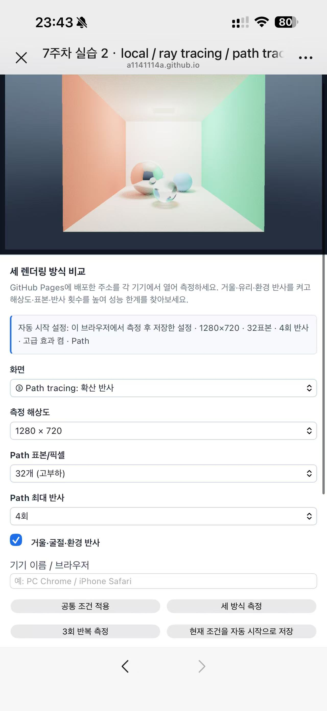

# Computer Graphics Week 07

전역 조명과 ray tracing / path tracing

- [Task 1: 일식·월식](https://a1141114a.github.io/week2/week7/task1.html?v=7.1)
- [Task 2: 기기별 성능 측정](https://a1141114a.github.io/week2/week7/task2.html?v=7.1)

교수님 제공 시작 코드를 바탕으로 제작한 컴퓨터 그래픽스(CG) 7주차 과제입니다.

[전체 보고서: week7.md](week7.md)

실습 1은 카메라 광선·구 교차·그림자 광선으로 일식과 월식을 구현하였습니다. 실습 2는 같은 장면을 Local / Ray / Path로 비교하고, Windows 컴퓨터와 iPhone 15 Pro Max에서 실제 성능을 측정하였습니다.

200 ms 이하를 기준으로 PC는 1920×1080 / 32표본 / 4회 / 고급 효과 켬, iPhone은 1280×720 / 32표본 / 4회 / 고급 효과 켬을 저장하였습니다. 브라우저별로 측정한 조건을 저장한 뒤 새로고침해 자동 적용을 확인하였습니다. PC의 GPU 시간과 iPhone의 동기화 포함 시간은 측정 방식이 달라 직접 속도 비율로 비교하지 않습니다.

## AI 활용

교수님 시작 코드의 구조 이해와 TODO 구현, 측정 기능 보완·검증, 한국어 보고서 정리에 AI의 도움을 받았다. 200 ms라는 허용 기준은 직접 정했으며, 휴대전화에서 조건별 측정·설정 저장·새로고침 확인과 실행 화면 기록을 직접 수행했다. 화질 비교 설명은 AI가 코드와 실행 화면을 바탕으로 정리한 내용이다.

