# Computer Graphics Week 07

전역 조명과 ray tracing · path tracing

- [실습 1: 일식·월식 실행](https://a1141114a.github.io/week2/week7/task1.html?v=7.1)
- [실습 2: 기기별 성능 비교 실행](https://a1141114a.github.io/week2/week7/task2.html?v=7.1)
- [GitHub 저장소](https://github.com/a1141114a/week2/tree/main/week7)

교수님이 제공한 `week07-raytrace-starter.zip`과 `week07-render-compare-starter.zip`을 바탕으로 제작하였다. 실습 1의 TODO 1–3을 구현하고, 실습 2에 실제 측정한 설정을 브라우저별로 저장·복원하는 기능과 측정 기록 복사를 추가하였다.

## 실습 1 — 기본 ray tracing으로 일식·월식 구현

### 구현과 빛의 경로

`task1.js`의 `cameraRay()`는 픽셀 좌표와 카메라의 forward·right·up으로 픽셀마다 다른 단위 광선 방향을 만든다. `hitSphere()`는 광선–구의 이차방정식 판별식을 계산하고, 두 근 중 가장 가까운 양수 거리를 반환한다. 작은 근이 음수일 때는 큰 근도 검사하므로 구 내부에서 시작한 광선에도 대응한다.

`traceScene()`은 별·행성·위성·바닥·뒷벽 중 가까운 표면을 찾는다. `shade()`는 교차점의 법선과 별 방향으로 직접광을 계산한다. 그림자 광선은 `p + N * 0.004`에서 시작한다. 별까지의 거리보다 가까운 다른 물체가 있으면 직접광을 차단한다. 작은 이동은 자기 표면을 다시 맞는 shadow acne를 줄인다.

화면의 사각형은 프래그먼트 셰이더를 실행하기 위한 것이다. 천체를 삼각형 구 메시로 래스터화하는 대신 픽셀별로 구와 광선의 교차를 직접 계산한다. 이 코드는 WebGL2 GPU 셰이더를 사용하지만 BVH나 전용 RT Core를 호출하지 않는다.

### 일식 — 공전 위치 0°

별—위성—행성 순서로 정렬된다. 그림자 광선을 켜면 위성이 별빛을 가려 행성 표면에 어두운 영역을 만든다. 같은 시점에서 스위치만 전환하였다.

| 그림자 광선 켬 | 그림자 광선 끔 |
| --- | --- |
| 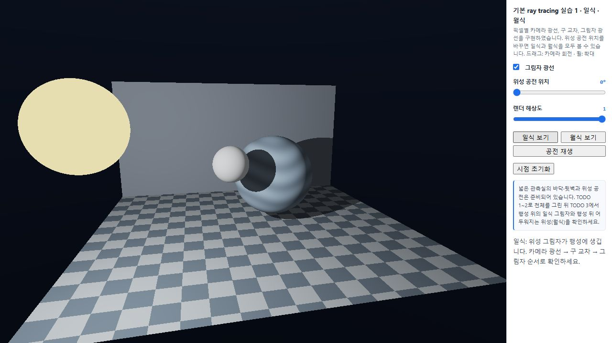 | 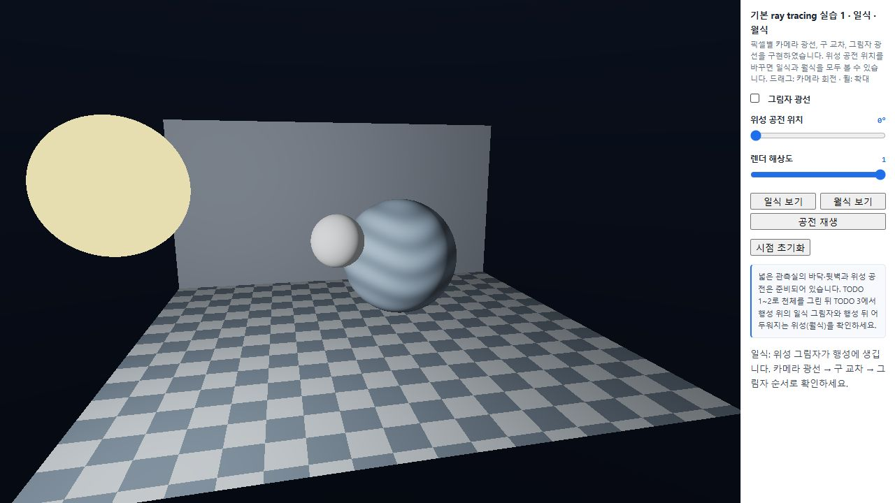 |

### 월식 — 공전 위치 180°

별—행성—위성 순서로 정렬된다. 행성이 별빛을 가려 위성이 어두워진다. 위성에는 윤곽을 확인하기 위한 작은 상수 ambient가 남는다. 실제 대기의 굴절로 생기는 붉은 달빛을 계산한 것은 아니다.

| 그림자 광선 켬 | 그림자 광선 끔 |
| --- | --- |
| 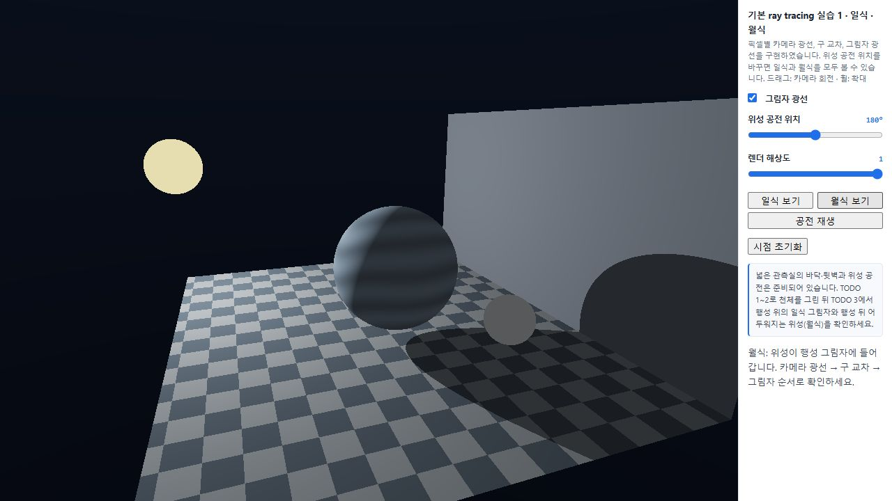 | 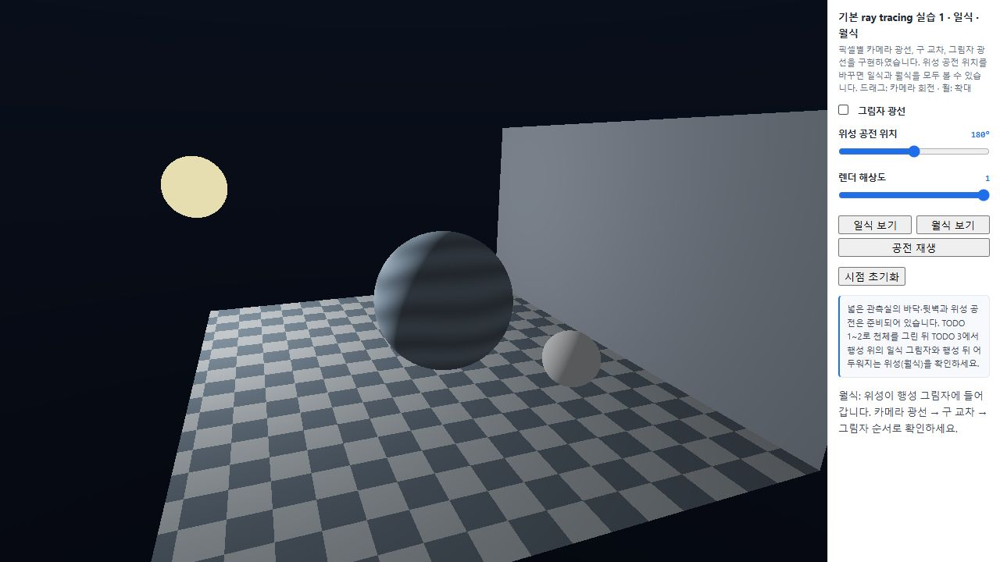 |

`일식 보기`, `월식 보기` 버튼으로 위치와 카메라를 맞추고, `공전 재생`으로 위성의 공전을 확인할 수 있다. 그림자는 직접광의 가림이며 다른 표면에서 반사된 간접 확산광과는 다르다.

## 실습 2 — 두 실제 기기의 화질·성능 비교

### 목적과 측정 환경

자주 설정을 바꾸며 비교하는 용도를 선택하였다. 허용 기준은 선택한 측정 방식에서 **한 번의 렌더 시간이 200 ms 이하**인 것이다. 이 수치는 전체 페이지 로딩 시간이나 모든 UI 입력의 지연 시간을 보장하는 값은 아니다.

| 기기 | GPU / CPU | 운영체제·브라우저 | 전원 및 모드 | 측정 방식 |
| --- | --- | --- | --- | --- |
| Windows 컴퓨터 | NVIDIA GeForce RTX 4080 Laptop GPU / CPU 확인 불가 | Windows, Codex 내장 Chromium 155 | 전원 연결, 성능 모드 | WebGL GPU 실행 시간 |
| iPhone 15 Pro Max | 브라우저 표시 Apple GPU / CPU 별도 확인 안 함 | iOS 26.6.2, WeChat 8.0.79 내장 브라우저 | 충전하지 않음, 저전력 모드 끔 | 브라우저 동기화 포함 경과 시간 |

처음에는 휴대전화의 Chrome을 사용할 계획이었으나 실제 제출 캡처의 user agent는 `MicroMessenger`이다. 따라서 실제 측정한 WeChat 내장 브라우저로 기록하였다. 두 기기는 동일한 개인 GitHub Pages 주소를 사용하였다.

각 측정 버튼은 방식별 1회 준비 렌더 후 5회 측정의 중앙값을 표시한다. 공통 조건은 세 번 반복하고 그 세 값의 중앙값을 다시 사용하였다. PC 적정 조건도 마지막 세 번의 반복 결과를 사용하였다. 나머지 부하 실험은 각 조건에서 프로그램이 표시한 5회 중앙값이다. GPU 타이머와 동기화 포함 시간은 **서로 다른 측정 방식**이므로 아래 PC와 휴대전화 숫자로 직접 속도 비율을 계산하지 않는다. 모바일의 정수 ms 값에도 실제 그 이하의 정밀도가 있다고 해석하지 않는다.

### 공통·고부하·적정 조건

조건은 해상도 / 픽셀당 Path 표본 / 최대 반사 / 고급 효과 순서이다. 시간 단위는 ms이다.

| 기기·조건 | 설정 | Local | Ray tracing | Path tracing | 판단 |
| --- | --- | ---: | ---: | ---: | --- |
| PC · 공통 | 640×360 / 8 / 2 / 켬 | 0.055 | 0.194 | 3.005 | 세 번 반복 중앙값 |
| iPhone · 공통 | 640×360 / 8 / 2 / 켬 | 1 | 1 | 5 | 세 번 반복 중앙값 |
| PC · 고부하 | 1920×1080 / 32 / 4 / 켬 | 0.027 | 0.123 | 26.206 | 최초 조합 시험 |
| iPhone · 고부하 | 1920×1080 / 32 / 4 / 켬 | 3 | 6 | 264 | 200 ms 기준 초과 |
| PC · 적정 | 1920×1080 / 32 / 4 / 켬 | 0.022 | 0.111 | 18.475 | 마지막 세 번 반복 중앙값, 기준 만족 |
| iPhone · 적정 | 1280×720 / 32 / 4 / 켬 | 2 | 4 | 112 | 해당 조건 세 기록 모두 Path 112 ms, 기준 만족 |

PC의 고부하와 적정 조건이 같은 이유는 제공 범위의 최대 설정에서도 기준을 만족했기 때문이다. 휴대전화는 같은 최대 조합에서 264 ms가 걸렸으므로 해상도를 한 단계 내려 112 ms의 조건을 선택하였다. 서로 다른 기기이기 때문에 무조건 다른 값을 고르는 것이 아니라, 각 기기에서 실제로 통과한 조합을 선택하였다.

| PC 공통 측정 화면 | 휴대전화 공통 측정 화면 |
| --- | --- |
| 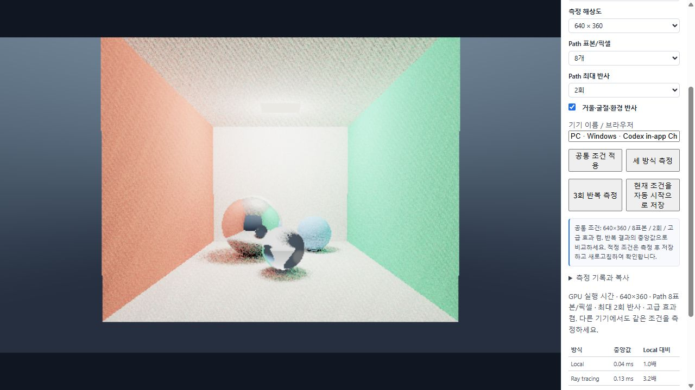 | 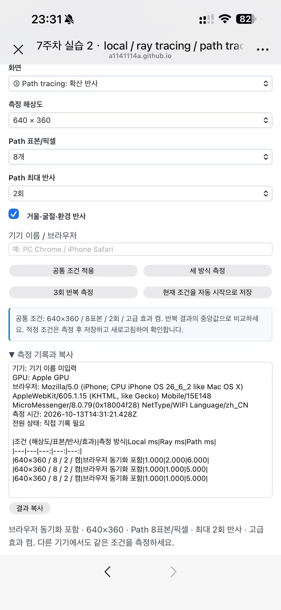 |

| PC 최초 고부하 | 휴대전화 고부하 | 휴대전화 적정 |
| --- | --- | --- |
|  | 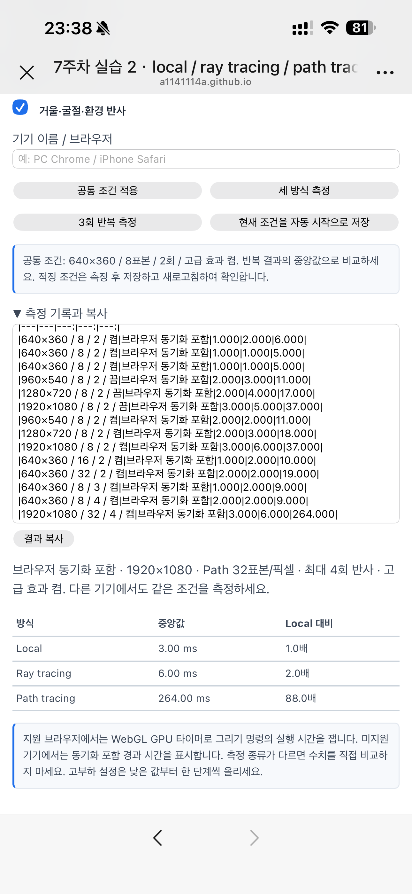 | 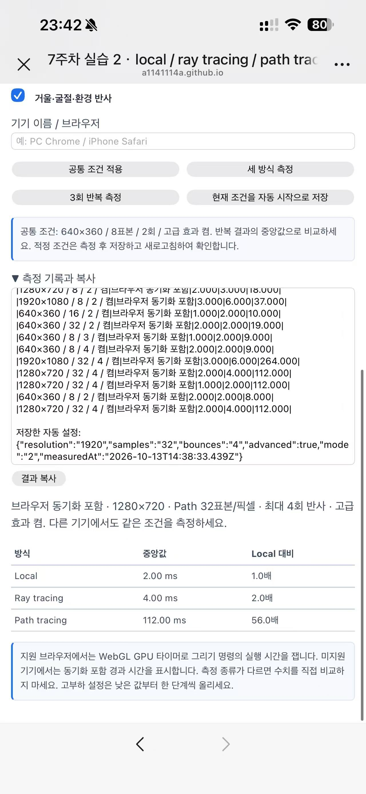 |

### 한 항목씩 바꾼 부하 실험

아래 휴대전화의 해상도 세 행은 고급 효과를 켜고 다시 측정한 기록이다. 고급 효과를 끈 앞선 기록과 섞지 않았다.

| 설정 | PC Local | PC Ray | PC Path | iPhone Local | iPhone Ray | iPhone Path |
| --- | ---: | ---: | ---: | ---: | ---: | ---: |
| 960×540 / 8 / 2 / 켬 | 0.074 | 0.374 | 5.785 | 2 | 2 | 11 |
| 1280×720 / 8 / 2 / 켬 | 0.070 | 0.411 | 9.615 | 2 | 3 | 18 |
| 1920×1080 / 8 / 2 / 켬 | 0.163 | 0.552 | 14.257 | 3 | 6 | 37 |
| 640×360 / 16 / 2 / 켬 | 0.053 | 0.195 | 8.886 | 1 | 2 | 10 |
| 640×360 / 32 / 2 / 켬 | 0.043 | 0.102 | 9.173 | 2 | 2 | 19 |
| 640×360 / 8 / 3 / 켬 | 0.024 | 0.086 | 2.628 | 1 | 2 | 9 |
| 640×360 / 8 / 4 / 켬 | 0.025 | 0.086 | 3.458 | 2 | 2 | 9 |

각 기기 내에서 보면 해상도와 표본 증가가 Path 비용을 크게 늘렸다. 휴대전화는 8→16→32표본에서 5→10→19 ms였고, 640→960→1280→1920 해상도의 Path 시간은 5→11→18→37 ms였다. 3회와 4회 반사 시간은 모두 9 ms로 표시되었다. 모든 픽셀이 최대 횟수까지 진행하지 않고 모바일의 시간 정밀도에도 한계가 있으므로 반사 한 회 증가가 언제나 같은 비율로 시간을 늘린다고 결론짓지 않는다.

PC의 일부 값은 설정이 높아져도 시간이 단조롭게 늘지 않았다. 이 기록만으로 원인을 확정할 수 없으며 GPU 클록·캐시·시스템 부하 같은 변동 가능성을 고려해야 한다. 큰 화질 차이와 반복 측정된 적정 조건을 함께 판단하였다.

고급 효과 비교는 같은 기기와 같은 설정 안에서 진행하였다. PC의 640×360 / 8 / 2에서 끔은 Local 0.024, Ray 0.079, Path 1.958 ms였다. 휴대전화의 1920×1080 / 8 / 2에서 끔은 3 / 5 / 37 ms, 켬은 3 / 6 / 37 ms였다. 이 휴대전화 기록에서는 Path 시간 차이가 표시되지 않았으며 효과가 무료라는 의미는 아니다.

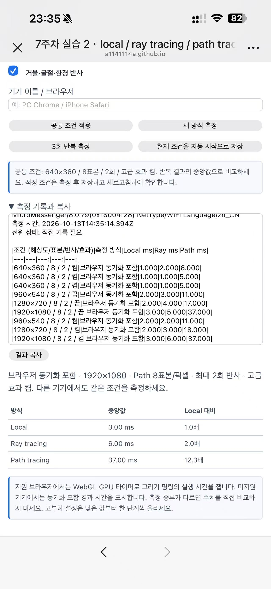
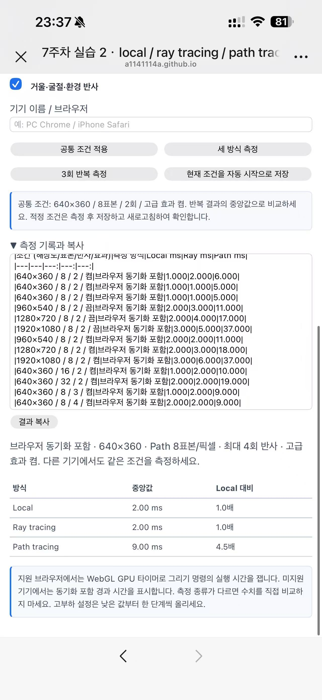

### 같은 장면의 화질 차이

다음은 개인 감상을 대신 작성한 문장이 아니라 구현과 실행 캡처에 근거한 화면 비교이다.

| Local | Ray tracing | Path tracing |
| --- | --- | --- |
| 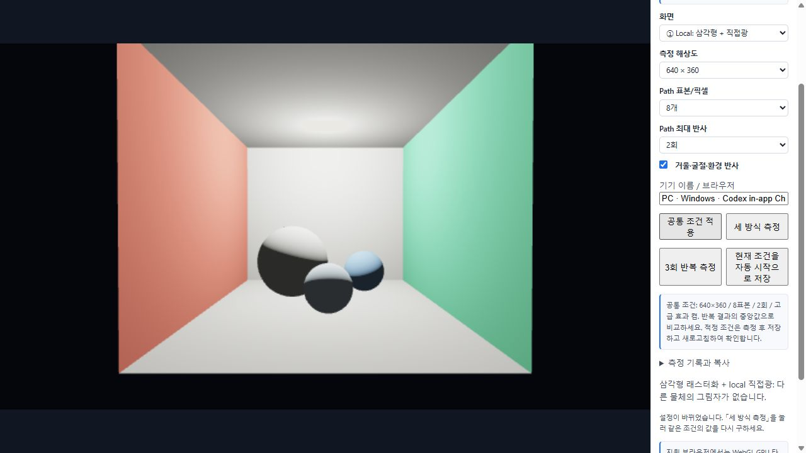 | 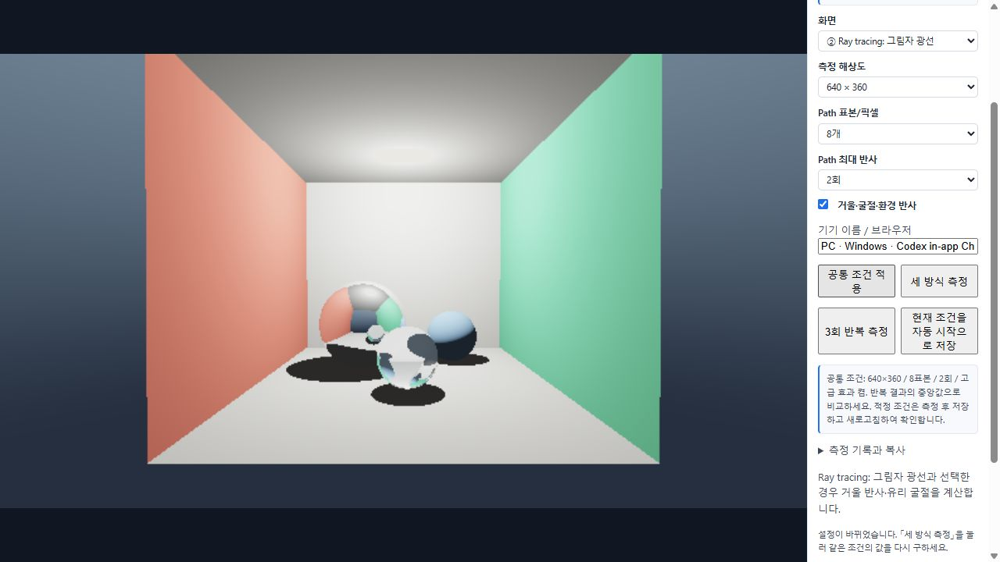 | 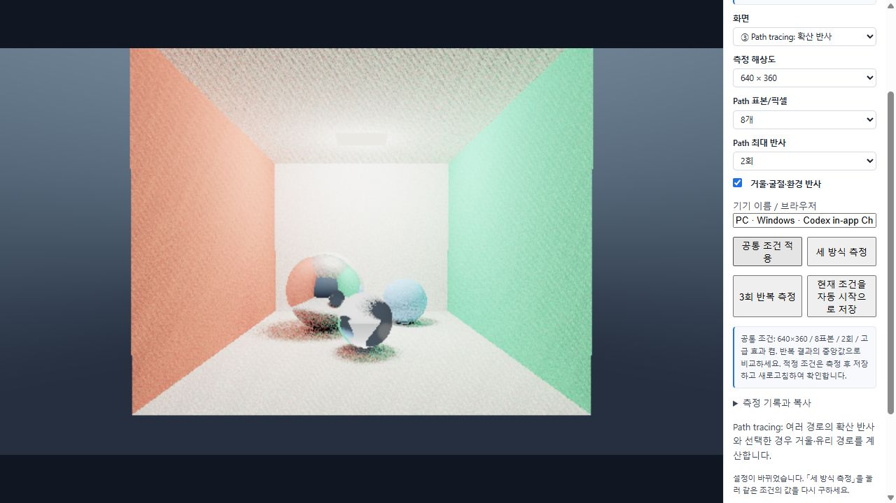 |

Local은 삼각형 래스터화와 직접광만 계산하므로 다른 물체가 만드는 그림자가 없고 거울·유리 구도 불투명한 표면처럼 보인다. Ray tracing은 그림자 광선과 고급 효과의 거울 반사·유리 굴절로 접촉 관계와 반사상이 나타나지만, 여러 확산 방향의 간접광은 계산하지 않는다. Path tracing은 확산 반사 방향을 표본 추출하여 벽 색이 다른 표면에 번지고 그늘의 밝기도 달라진다. 적은 표본에서는 점무늬 노이즈가 남으며 표본을 늘리면 더 안정되지만 계산량이 증가한다. 해상도는 세부 표현에, 표본은 노이즈에 영향을 준다.

### 측정 결과에 따른 자동 시작

`chooseInitialProfile()`은 `localStorage`의 `cg-week7-profile-v1`을 읽고 해상도·표본·반사·효과·표시 방식의 값을 검증하여 적용한다. 저장값이 없는 처음 접속에는 미측정임을 명시한 안전한 시작값을 쓴다. 이를 최종 적정 설정으로 주장하지 않으며, 실제 측정 후 저장한 값이 다음 접속부터 우선한다.

`현재 조건을 자동 시작으로 저장`은 현재 조건과 일치하는 측정 기록이 있는지 확인한 뒤 이 브라우저에 저장한다. `#profile`에 적용값을 표시하고 페이지가 열리면 해당 화면을 자동 렌더링한다. PC와 휴대전화에서 각각 저장 후 새로고침한 결과를 확인하였다. 같은 기기라도 다른 브라우저나 사이트 저장 공간을 지운 상태에는 별도 저장이 필요하다.

| PC 새로고침 후 | iPhone 새로고침 후 |
| --- | --- |
| 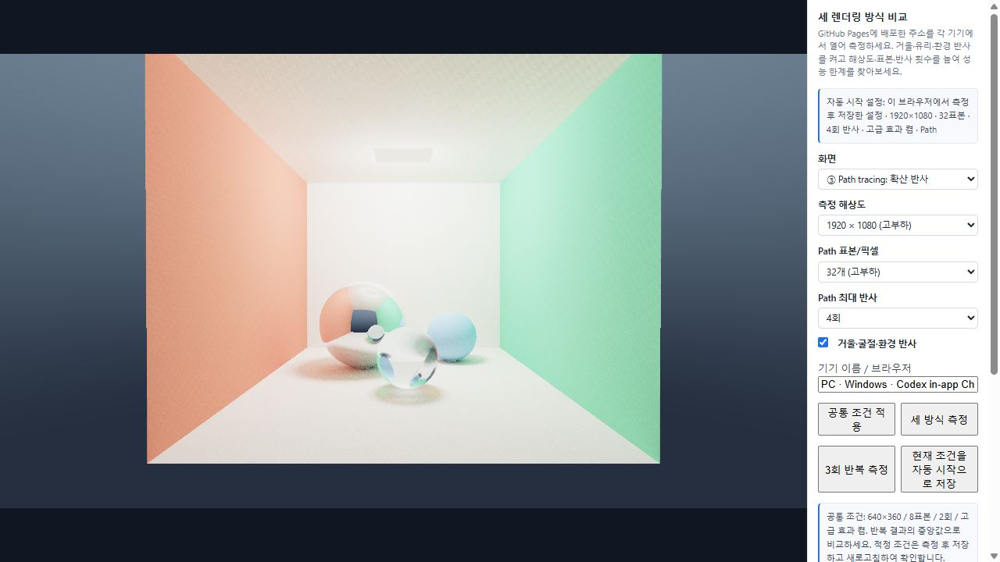 |  |

## AI 활용

AI는 교수님 제공 코드의 TODO 1–3 구현, 측정 기록 복사 및 브라우저별 설정 저장 기능, 실제 측정 자료 정리와 한국어 보고서 문장 작성에 활용하였다. 사용자가 휴대전화에서 직접 측정·저장·새로고침하고 캡처를 제공하였다. 허용 기준과 전원 상태는 사용자가 설명하였다. 화질 설명은 사용자 요청에 따라 코드와 실행 캡처를 근거로 정리하였다. 휴대전화의 측정 방식이 PC와 다르고 실제 브라우저가 WeChat인 점을 확인해 구분하였다.

## 자료와 실행 범위

- [CG 7주차 교수님 자료](https://cg.catholic.ac.kr/~mgchoi/CG/weeks/week07/)
- [실습 1 시작 ZIP](https://cg.catholic.ac.kr/~mgchoi/CG/downloads/week07-raytrace-starter.zip)
- [실습 2 시작 ZIP](https://cg.catholic.ac.kr/~mgchoi/CG/downloads/week07-render-compare-starter.zip)

장면과 공용 도구·렌더링 비교 셰이더는 교수님 시작 코드에서 출발하였다. 별도의 외부 사진이나 텍스처는 사용하지 않았으며 보고서 이미지는 실제 실행 화면이다. 실습 2는 WebGL2 셰이더에서 교차를 직접 계산하며 전용 RT Core나 BVH를 사용하지 않는다. Photon mapping은 강의에서 비교한 기법이며 이 과제의 구현 항목은 아니다.
